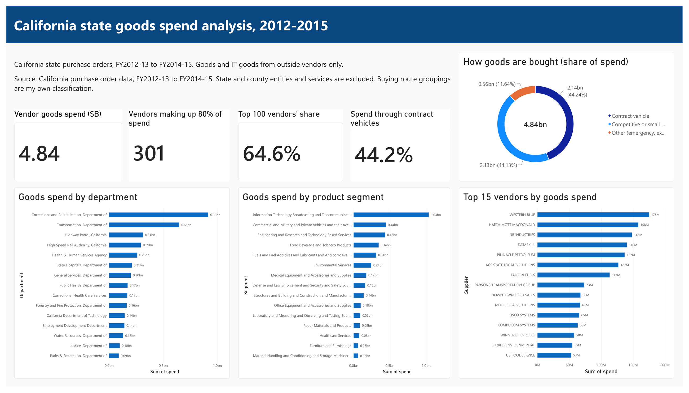
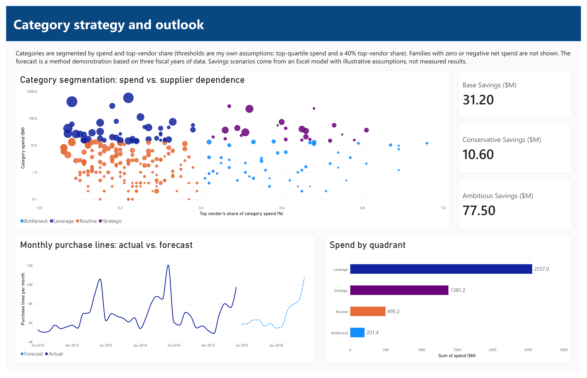

# California State Procurement Spend Analysis

## Project Overview
This project analyzes about 344,000 purchase order lines from California state departments (fiscal years 2012-13 to 2014-15) to understand where goods spend goes, how concentrated it is among vendors, how it is bought, and where consolidation could save money. The analysis cleans the raw purchase orders, builds a spend cube, segments product categories with a Kraljic matrix, checks price variance on a small set of comparable items, forecasts monthly purchasing, and estimates savings with a simple scenario model.

**Dashboard:** `procurement_dashboard.pbix` (open in Power BI Desktop). 

## Tools Used
SQL (DuckDB), Python (Google Colab, forecasting only), Excel, Power BI

## Dataset
[Purchase Order Data 2012-2015](https://data.ca.gov/dataset/ae343670-f827-4bc8-9d44-2af937d60190) (California Open Data Portal) (California Open Data Portal, data.ca.gov). The raw file has 344,504 lines across 197,000 purchase orders and three fiscal years. Key fields include department, supplier, acquisition type and method, item name and description, UNSPSC segment and family, quantity, unit price and total price. The raw CSV is not included in this repo.

About 264,000 raw lines are goods (non-IT and IT). The rest are services and telecommunications, which are excluded from the main analysis.

## Project Goals
- Show where state goods spend goes, by department, product segment, and vendor
- Measure how concentrated spend is among vendors
- Compare contract-vehicle buying with competitive and small purchases
- Segment categories by spend and supplier dependence (Kraljic matrix)
- Check price variance on items that are comparable across vendors
- Forecast monthly purchasing activity
- Estimate what supplier consolidation and price discipline could be worth

## Data Analysis

### Data Preparation
SQL was used to load the raw file as text, then parse dates, prices (including credits shown as "($7.00)") and quantities, drop exact duplicate rows, and standardize supplier names so the same vendor is not split across spellings. State and county entities were flagged so supplier analysis covers outside vendors only. A goods table was built with positive price, quantity, and unit price, covering about $4.84B of vendor goods spend.

### Spend Analysis
A spend cube was built by department, segment, family, vendor, and buying method. Pareto analysis shows how many vendors make up 80% of spend, and the top 100 vendors' share. Fragmentation was measured as the number of vendors per product family.

### Buying Routes
Acquisition methods were grouped into contract vehicles (statewide contracts, CMAS, master agreements and similar), competitive or small purchases, and other (emergency, exempt, programs). The grouping is my own classification.

### Kraljic Segmentation
Product families with at least 30 lines were placed in a Kraljic matrix using spend and the top vendor's share of the family's spend. Families above the top quartile of spend with a top-vendor share of 40% or less are Leverage, above both are Strategic, below the spend cutoff with a high top-vendor share are Bottleneck, and the rest are Routine. The thresholds are my own assumptions.

### Price Variance
Price variance was measured as spend above the median unit price for the same item, with a cap on extreme outliers. Because item descriptions are free text and the data has no units, an automated screen across all items is only an upper bound. Only five hand-validated commodity items (such as toner, fuel, and deicing sand) are reported.

### Forecast
Monthly purchase lines and spend were forecast with a seasonal naive method, a seasonal average, and Holt-Winters, using a 12-month holdout backtest scored by MAPE.

### Scenario Model
An Excel model estimates savings from moving part of Leverage-family spend to preferred vendors at a discount, plus capturing part of the validated price gap. It has conservative, base, and ambitious scenarios.

## Dashboard Features
**Spend Overview**
Four cards (vendor goods spend, vendors making up 80% of spend, top 100 vendors' share, spend through contract vehicles), a donut of buying routes, and bar charts of goods spend by department, product segment, and top 15 vendors.

**Categories and Outlook**
A Kraljic scatter plot (spend versus top-vendor share, colored by quadrant), spend by quadrant, a chart of monthly purchase lines with the forecast, and three savings scenario cards.

## Key Insights
- **Goods spend from outside vendors is $4.84B over three fiscal years.** The largest buyers are Corrections and Rehabilitation ($0.92B), Transportation ($0.65B), and the Highway Patrol ($0.31B).
- **Spend is concentrated.** 301 of 9,037 vendors (about 3%) account for 80% of spend, and the top 100 vendors hold 64.6%.
- **Buying is split three ways.** Contract vehicles are 44.2% of spend, competitive or small purchases 44.1%, and other routes 11.6%.
- **Leverage categories hold the most spend.** Spend by quadrant is about $2.56B Leverage, $1.38B Strategic, $0.50B Routine, and $0.20B Bottleneck. Leverage families have many suppliers and no dominant vendor, which makes them the best candidates for consolidation.
- **Some families are highly fragmented.** Office machines, paper, and computer equipment are spread across hundreds of small vendors.
- **Price variance is small on comparable items.** On five hand-validated commodity items, the gap above median price is about $0.74M, or 2.5% of $29.4M of spend.
- **Purchasing has a strong seasonal pattern.** The best backtest for purchase lines was the seasonal average (9.8% error, versus 13.2% for seasonal naive and 17.0% for Holt-Winters). For spend, Holt-Winters did best at 21.9% error.
- **Savings scenarios range from $10.6M to $77.5M.** That is about 0.2% to 1.6% of vendor goods spend.

## Recommendation
Start consolidation in Leverage families with many suppliers and no dominant vendor, and use contract vehicles for them where one exists. Keep Strategic families, where one vendor holds a large share, under active supplier management to reduce dependence risk. Rather than relying on a broad price screen, build a clean item master with units so price variance can be measured reliably.

## Limitations
- The data covers 2012 to 2015 and one state, so findings are a method demonstration, not current spend.
- Item names are free text and there are no units, so price comparisons are limited to a few hand-validated items. The automated price variance is an upper bound.
- Services make up most of the raw dollars, so the analysis is scoped to vendor goods, about $4.84B.
- The contract-vehicle grouping and the Kraljic thresholds are my own assumptions.
- Qualification data (such as small business status) is present on only about 31% of spend, so it is not used.
- The forecast uses three fiscal years, which is thin for seasonal methods, so it is a demonstration of the method, not a planning forecast.
- Savings figures come from a scenario model with illustrative shares and discounts, not from benchmarks or measured results.

## Project Takeaways
I used SQL, Python, Excel, and Power BI to build a procurement analysis from a messy public dataset. The project helped me practice cleaning free-text supplier and item data, building a spend cube, and using Pareto and Kraljic views to decide where to focus. It also taught me to be careful about what the data can support: I reported only the price variance I could validate by hand, backtested the forecast before trusting it, and labeled the savings model as illustrative.

## Repo Contents
| File | What it does |
|---|---|
| `01_load_and_checks.sql` | Loads the raw CSV into DuckDB and checks row counts |
| `02_clean.sql` | Parses fields, removes duplicates, standardizes suppliers, flags state and county entities, builds the goods table |
| `03_spend_analysis.sql` | Spend cube, Pareto, vendor concentration, and fragmentation queries |
| `04_kraljic.sql` | Builds the Kraljic segmentation table |
| `05_price_variance.sql` | Price variance screen and hand-validated commodity items |
| `06_exports.sql` | Exports CSVs for Excel, Power BI, and the forecast notebook |
| `forecast.ipynb` | Forecast backtest and forecast (Python, Colab) |
| `forecast_goods.csv` | Actual and forecast monthly purchase lines and spend |
| `procurement_savings_model.xlsx` | Savings scenario model |
| `procurement_dashboard.pbix` | Power BI report (two pages) |
| `dashboard/` | Dashboard screenshots |
